# Deploying a Highly Available WordPress Website on AWS

A hands-on cloud lab: a WordPress site that runs on EC2, stores its data in a separate Amazon RDS database, sits behind an Application Load Balancer, and scales automatically with an Auto Scaling Group.

The lab was originally written for Huawei Cloud (KooLabs). I rebuilt it on **AWS** using a free-plan account, so a few services and settings differ (see [Huawei Cloud → AWS mapping](#huawei-cloud--aws-mapping)).

## Requirements from the lab

1. Database nodes and service (web) nodes run on separate servers.
2. Servers are added or removed automatically as incoming traffic changes.

## Architecture

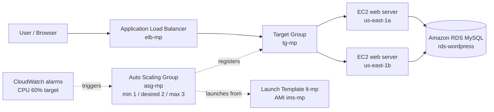

## Huawei Cloud → AWS mapping

| Huawei Cloud | AWS used here |
|---|---|
| VPC | Default VPC |
| Security Group | Security Group (`wordpress_sc`) |
| ECS (s6.small.1, CentOS 7.6) | EC2 `t3.micro`, Amazon Linux 2023 |
| RDS MySQL (primary/standby) | RDS MySQL, single-AZ, `db.t4g.micro` (free tier) |
| ELB (shared) | Application Load Balancer |
| IMS image | AMI |
| AS configuration | Launch Template |
| AS group and policies | Auto Scaling Group + target-tracking policy |
| Cloud Eye | CloudWatch |

Other differences: Amazon Linux 2023 uses `dnf` instead of `yum`, WordPress is installed from the latest release into the web root (`/var/www/html`), and a single target-tracking policy (average CPU 60 %) replaces the two separate "add at ≥ 60 %" and "remove at ≤ 20 %" policies.

## Steps

### 1. Network and security
- Used the **Default VPC** (`vpc-…`) with its public subnets in two Availability Zones.
- Created security group `wordpress_sc` with inbound HTTP (80), SSH (22), HTTPS (443) and MySQL (3306).

| VPC | Security group |
|---|---|
| 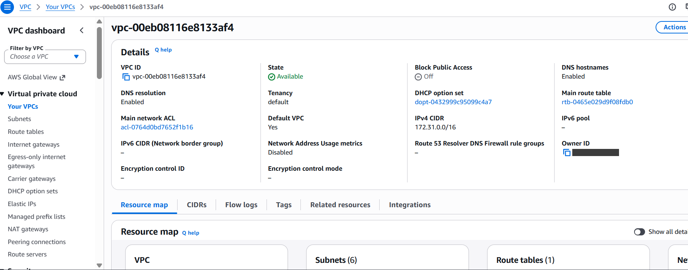 | 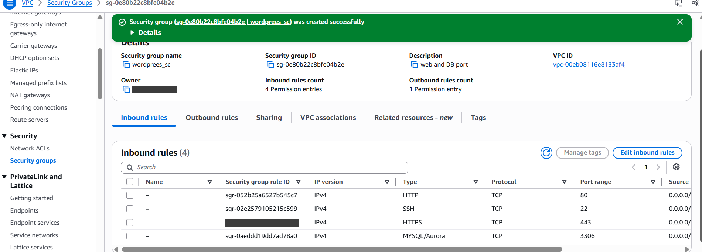 |

> For a production setup, open 3306 only to the web servers' security group and restrict SSH to your own IP. Open rules were used here only because the environment lives for a few hours.

### 2. Web server (EC2)
- Launched one `t3.micro` instance with Amazon Linux 2023 and connected with EC2 Instance Connect.

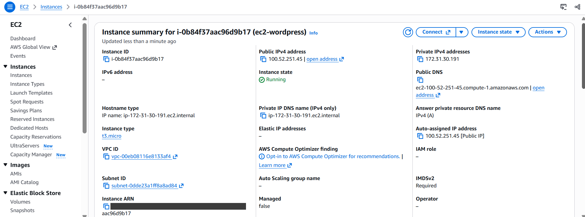

### 3. Database (RDS)
- Created an RDS MySQL instance (`rds-wordpress`), single-AZ, free-tier template, **not** publicly accessible, with initial database name `wordpress`.

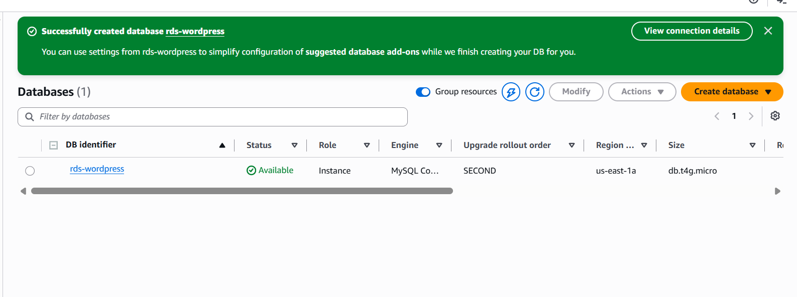

### 4. Install LAMP and WordPress
Script: [`scripts/install-lamp-wordpress.sh`](scripts/install-lamp-wordpress.sh)

```bash
sudo dnf install -y httpd php php-fpm php-mysqlnd mariadb105 wget
sudo systemctl enable --now httpd php-fpm
cd /tmp && wget https://wordpress.org/latest.tar.gz && tar -xzf latest.tar.gz
sudo cp -r wordpress/* /var/www/html/
sudo chown -R apache:apache /var/www/html
```

| Install | Services running |
|---|---|
| 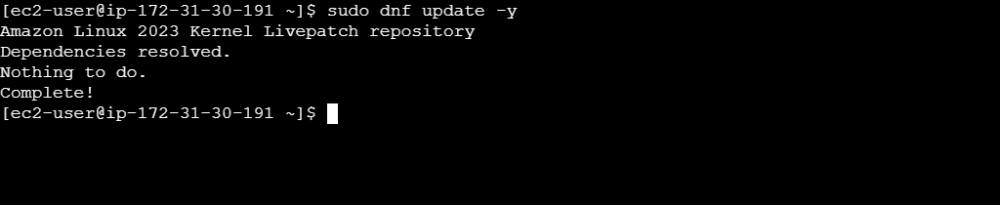 | 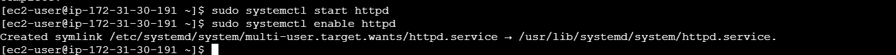 |

### 5. WordPress setup wizard
Entered the RDS endpoint as *Database Host*, then installed WordPress.

| Database details | Site details | Dashboard | Site |
|---|---|---|---|
| 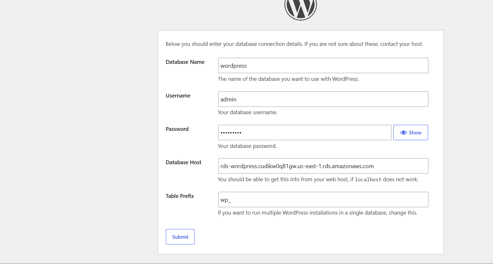 | 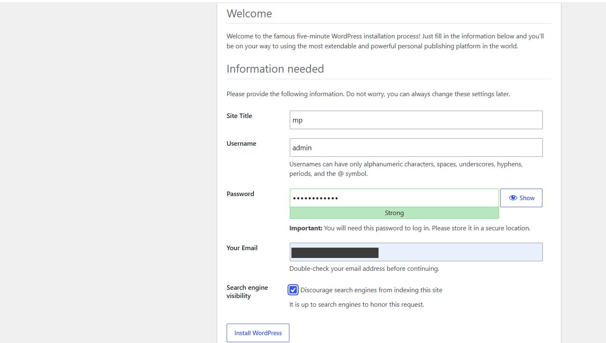 | 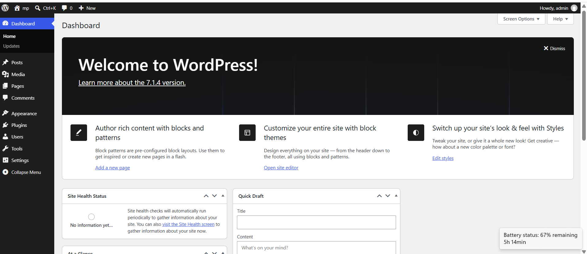 | 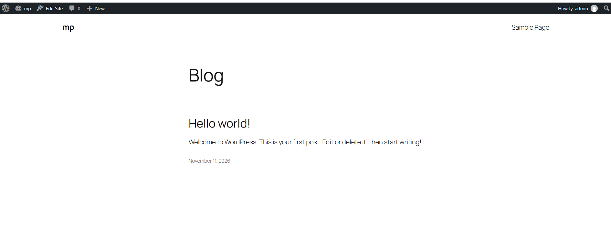 |

### 6. Make the site work behind a load balancer
WordPress stores its address in the database, so it would redirect back to the original EC2 IP. Fixed with [`scripts/wp-config-dynamic-url.sh`](scripts/wp-config-dynamic-url.sh), which makes `WP_HOME` / `WP_SITEURL` follow the host name of the request.

### 7. Create an AMI and a Launch Template

| AMI | Launch template |
|---|---|
| 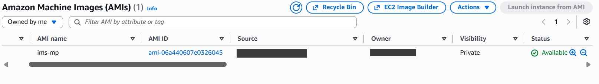 | 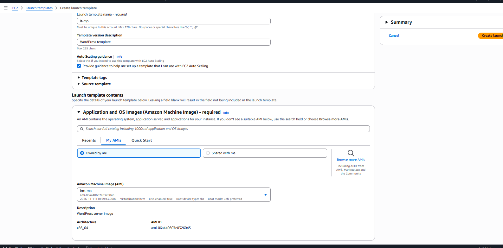 |

### 8. Target Group and Application Load Balancer
- Target group `tg-mp` (HTTP:80, health check `/`, success codes `200-399`).
- Internet-facing ALB `elb-mp` across two Availability Zones, forwarding HTTP:80 to `tg-mp`.

| Target group | Load balancer |
|---|---|
| 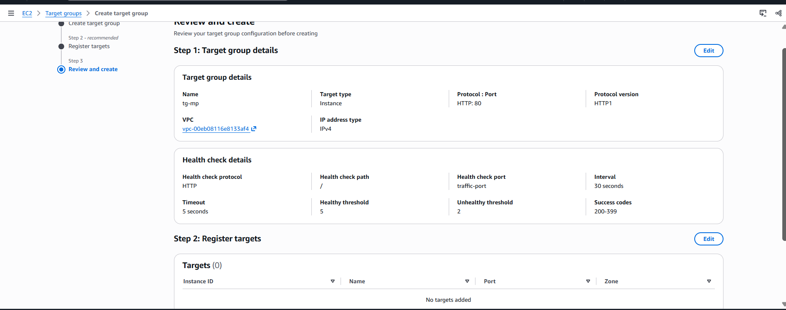 | 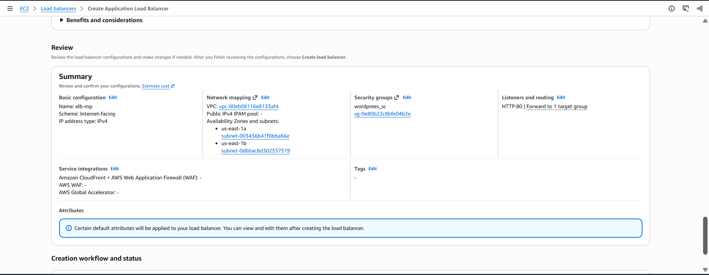 |

### 9. Auto Scaling Group
- `asg-mp`: launch template `lt-mp`, attached to `tg-mp`, ELB health checks on.
- Capacity: **min 1 / desired 2 / max 3**.
- Policy: target tracking, **average CPU utilization 60 %**.

| Load balancing | Size and scaling | Two instances running |
|---|---|---|
| 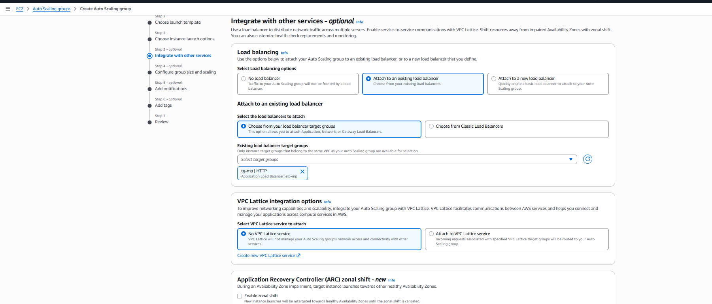 | 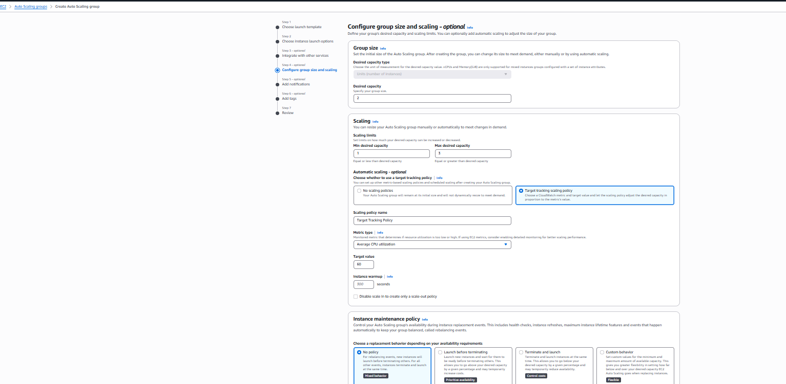 | 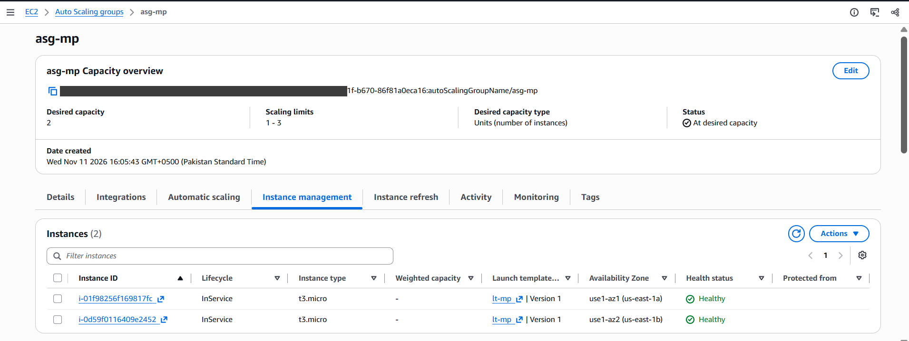 |

## Results

### Two healthy servers behind the load balancer
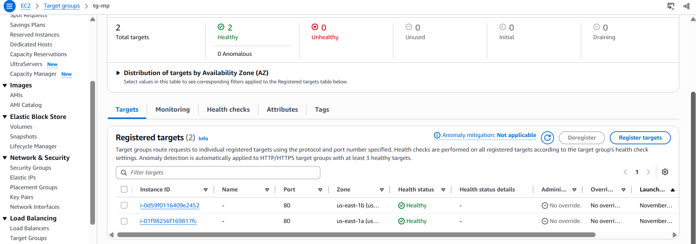

### Website served through the load balancer
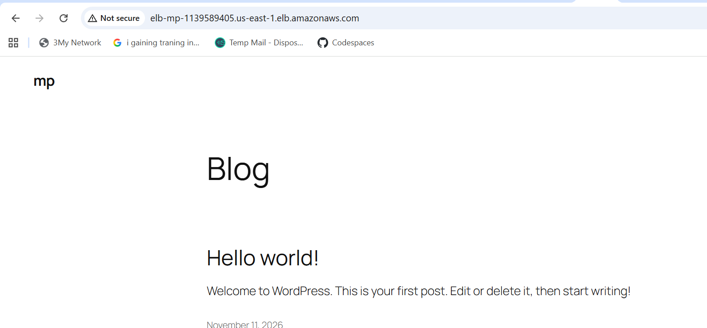

### Which server answered?
A small test page (`/server.php`, see [`scripts/server-name-test.sh`](scripts/server-name-test.sh)) shows the name of the server that handled the request.

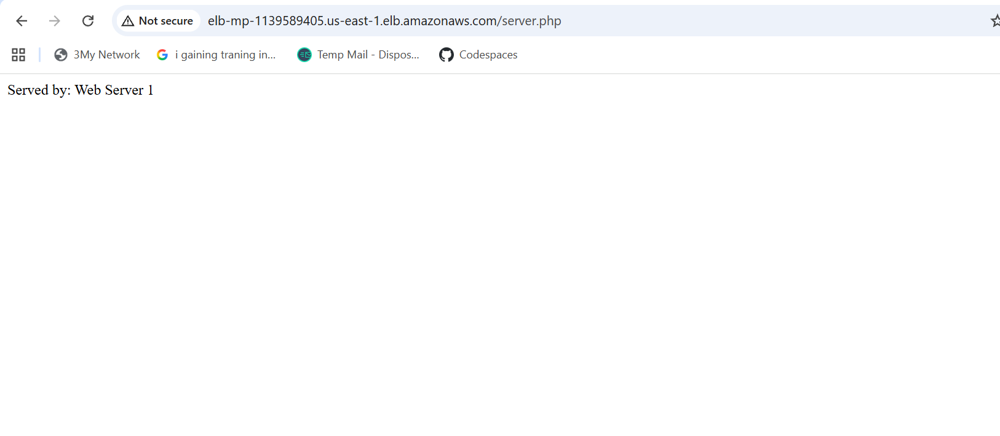

### Auto Scaling scaled in by itself
The servers were idle, so CPU stayed far below the 60 % target. The `AlarmLow` CloudWatch alarm fired and the Auto Scaling Group reduced the desired capacity from **2 to 1**, terminating one instance.

| Activity history | CloudWatch alarms |
|---|---|
| 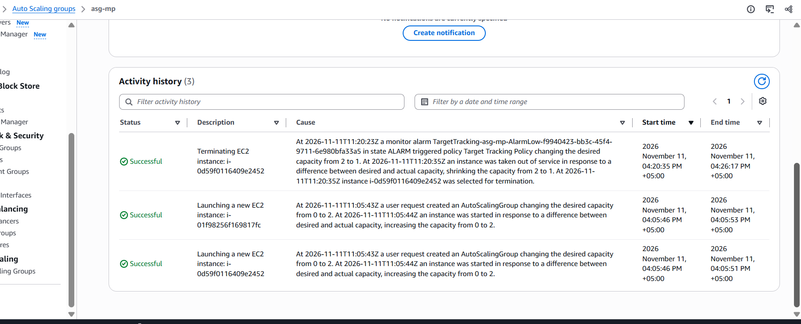 | 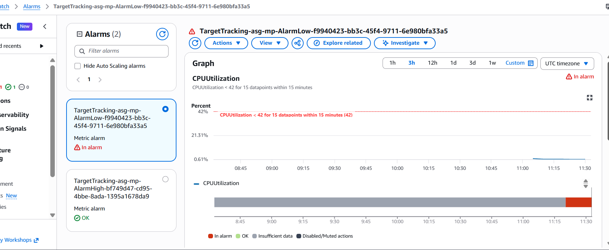 |

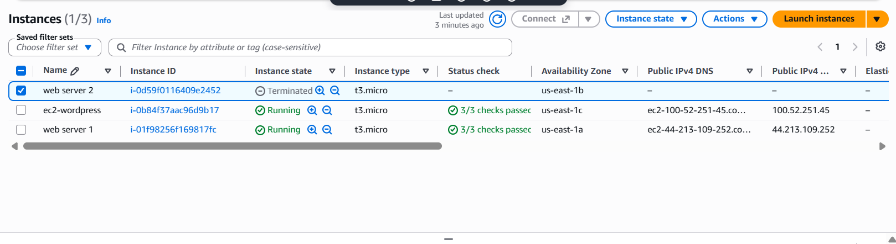

## Cost and clean-up
Everything was created and deleted within a few hours on the AWS free plan (estimated cost well under US$1). Resources were removed in this order:

1. Auto Scaling Group → 2. Load Balancer → 3. Target Group → 4. RDS database (no final snapshot) → 5. EC2 instance → 6. AMI (deregister) and its snapshot → 7. Launch Template → 8. Security group.

## What I learned
- Splitting the web tier and database tier makes each one scale and fail independently.
- An AMI plus a Launch Template lets Auto Scaling create identical servers.
- Applications that store their own URL (like WordPress) need extra configuration to work behind a load balancer.
- Target-tracking policies scale in as well as out, so idle servers are removed automatically.
- Always delete the load balancer, database and snapshots when you finish; these are the resources that keep costing money.

## Repository layout

```
.
├── README.md
├── scripts/
│   ├── install-lamp-wordpress.sh
│   ├── wp-config-dynamic-url.sh
│   └── server-name-test.sh
└── screenshots/        # 48 numbered screenshots (AWS account ID and e-mail hidden)
```
